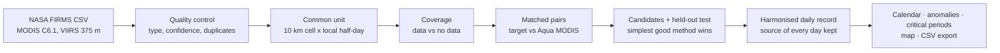

# PyroHarmonize

**A burning activity calendar that puts MODIS and VIIRS active-fire records on one scale, and shows how well that works.**

NASA Space Apps Challenge 2026 · challenge: *Harmonization of MODIS and VIIRS Hot Spots* · [challenge page](https://www.spaceappschallenge.org/2026/challenges/modis-and-viirs-hot-spots/)

[](https://github.com/Jeeson-Kurian/pyro-harmonize/actions/workflows/tests.yml)
[](LICENSE)

---

## Status: read this first

| | |
|---|---|
| Real-data pipeline (download, quality control, harmonisation, validation, web app) | **Implemented and covered by automated tests** |
| Evidence that the method works | **On simulated data only so far** (`docs/synthetic_selftest/REPORT.md`). A simulation shows the software is correct. It says nothing about real satellites. |
| Real NASA FIRMS case study | **Produced by two commands** (below). Until `data/firms/` contains FIRMS files, the app runs in a clearly labelled synthetic demo mode. |

If `docs/case_study/REPORT.md` exists in this repository, it is the real-data result and the numbers quoted anywhere else should come from it.

## The problem

Satellites have recorded active-fire hot spots since late 2000, but the record is split across instruments that cannot be compared directly. A MODIS pixel is about 1 km wide (and grows toward the edge of the swath); a VIIRS pixel is 375 m. One fire front is one MODIS hot spot and many VIIRS hot spots, VIIRS sees smaller fires, and there are now up to three VIIRS satellites. A plain hot-spot count therefore jumps when VIIRS starts and again with every added satellite, with no change in burning.

This matters now: Suomi-NPP stopped delivering data on 2 November 2026 and the two MODIS instruments are near the end of their missions. The record has to continue on NOAA-20 and NOAA-21 without a break in meaning.

## The approach

1. **One unit for every sensor.** Hot spots are reduced to *active fire cells*: 10 km equal-area grid cells per local day or night. This removes most of the pixel-size effect before any modelling.
2. **One reference scale.** Everything is expressed as "what Aqua MODIS would have reported". A coarse sensor cannot be upgraded to see what it missed, but a fine one can be degraded. Aqua shares the early-afternoon orbit with every VIIRS satellite; Terra (morning orbit) is handled separately.
3. **Calibration on matched observations.** For cells that a VIIRS platform reports, a model estimates the probability that Aqua MODIS reports them too, and their expected Aqua FRP.
4. **Held-out validation decides.** The model competes with simple baselines on years it has not seen, and on a forward-in-time split. The simplest method within 2 % of the best is used. If the data are too thin to validate anything, the platform is reported as "not calibrated" and left out. There are no fallback numbers in the code.
5. **Missing is not zero.** Days without data coverage are shown as missing everywhere. Several satellites are averaged, never added.



Full description with equations and limits: [docs/METHODS.md](docs/METHODS.md).

## What the web app does

- **Any area, any period**: type a bounding box or copy it from the map, pick dates.
- **Burning activity calendar** (year x day of year): harmonised active cells, harmonised FRP, raw MODIS hot spots, raw VIIRS hot spots, and a view of which sensor each day comes from.
- **Validation panel**: held-out comparison against Aqua MODIS, every method in one table, the one in use marked.
- **Is this month unusual?** Anomaly against the same calendar month in other years, with percentile, coverage and a 90 % range.
- **Critical periods**: typical and busy weeks of the year, peak week, core season.
- **Fire season timing** per fire year, with trends reported as observed changes and no cause assigned.
- **Sensor comparison**: detection probability by FRP and FRP of cells seen by both.
- **Map of hot-spot clusters** (geodesic DBSCAN per overpass) and a clustering-radius sensitivity table.
- **CSV export** of detections (with FIRMS source, version and processing level), the daily record and the monthly record.

## Quick start

```bash
git clone https://github.com/Jeeson-Kurian/pyro-harmonize.git
cd pyro-harmonize
pip install -r requirements.txt -r requirements-dev.txt
python -m pytest -q          # automated tests
python app.py                # http://127.0.0.1:8000  (synthetic demo until you add data)
```

### Use real NASA data

1. Get a free FIRMS MAP_KEY: <https://firms.modaps.eosdis.nasa.gov/api/map_key/>
2. Download one area and period (west,south,east,north):

```bash
export FIRMS_MAP_KEY=your_key            # Windows PowerShell: $env:FIRMS_MAP_KEY="your_key"
python data/download_nasa_firms.py --bbox -124,36,-119,41 --start 2012-01-20 --end 2024-12-31 \
       --sources MODIS_SP,VIIRS_SNPP_SP,VIIRS_NOAA20_SP
```

The script requests 5 days at a time, caches every request, retries failures, and writes `data/firms/manifest.json`, which records exactly which dates were retrieved. Re-running the same command resumes and retries only what failed. For the long MODIS-only record add a second run with `--start 2000-11-01 --sources MODIS_SP`.

Files from the FIRMS archive download tool (<https://firms.modaps.eosdis.nasa.gov/download/>) also work: put the CSVs in `data/firms/`.

3. Produce the validation report and start the app:

```bash
python scripts/run_case_study.py --update-readme   # writes docs/case_study/ and fills "Real-data result" below
python app.py
```

Steps 2 and 3 in one command (asks for the key if `FIRMS_MAP_KEY` is not set):

```bash
python scripts/make_submission.py
```

Commit `data/firms/*.csv`, `data/firms/manifest.json` and `docs/case_study/` so that others can reproduce the result.

Settings: `PYRO_DATA_DIR` (other data folder), `PYRO_DEMO=1` (force the synthetic demo), `HOST`, `PORT`.

## Real-data result

<!-- CASE_STUDY:START -->
Not produced yet. Run `python scripts/make_submission.py` (see "Use real NASA data"). The script fills this section with the numbers from `docs/case_study/REPORT.md`.
<!-- CASE_STUDY:END -->

## Self-test on simulated data

`python scripts/run_case_study.py --demo --out docs/synthetic_selftest` runs the whole pipeline on a simulator that is independent of the harmonisation code (fires with sub-pixel structure, pixel footprints, detection limits, cloud, separate orbits, a sensor outage). In that simulated world:

| Suomi-NPP VIIRS compared with Aqua MODIS, held-out years | Total difference |
|---|---:|
| Raw hot-spot counts | +217 % |
| Common grid only | +143 % |
| After harmonisation (cross-validation) | 0 % (median monthly error 6 %) |
| After harmonisation (forward-in-time test) | +3 % |

In a blind test on a second simulated world (`tests/test_harmonization.py`), Aqua was hidden for the last four years and reconstructed from VIIRS: the monthly totals matched the hidden Aqua record within 2 % overall (correlation 0.997), and 94 % of months fell inside the 90 % range.

**These numbers describe the simulator, not the Earth.** They show that the code does what it says. Real-data numbers come from `docs/case_study/REPORT.md`.

## Implemented and not implemented

| Implemented | Not implemented |
|---|---|
| FIRMS API downloader with manifest, caching, retries | Automatic download from inside the web app |
| Ingestion of API and archive CSV layouts, SP and NRT | Cloud and swath masks (not available from hot-spot files) |
| Quality control with per-rule counts | Land-cover or biome-specific calibration |
| Equal-area cells, local-solar half-days, geodesic clustering | Fire radiative energy (time-integrated FRP) |
| Per-platform calibration with held-out and forward tests | Validation across many regions |
| Aqua-equivalent daily record with per-day source | Forecasting |
| Empirical 90 % range for sensor-converted months | Formal error propagation |
| Calendar, anomalies, critical weeks, fire-year seasonality | Polygon areas (bounding boxes only) |
| CSV export with provenance | |

## Data and citation

Active-fire data come from NASA FIRMS (Fire Information for Resource Management System), part of NASA's LANCE / EOSDIS: MODIS Collection 6.1 active fire products (Terra, Aqua) and VIIRS 375 m active fire products (Suomi-NPP, NOAA-20, NOAA-21). <https://firms.modaps.eosdis.nasa.gov/>

We acknowledge the use of data from NASA's Fire Information for Resource Management System (FIRMS), part of NASA's Earth Science Data and Information System (ESDIS).

## Limits

- A result for one area does not validate the method elsewhere. Run the case study for each area you care about.
- Hot-spot files do not say where the satellite looked and saw nothing, or where cloud hid the ground.
- FRP values are instantaneous power at overpass time. They are not energy.
- Terra-derived values (before July 2002) cross the diurnal cycle and are the least certain part of the record.
- Trends are observed changes in a mixed-sensor record. No cause is assigned.
- Not for operational fire-fighting decisions.

More in [docs/METHODS.md](docs/METHODS.md), section 11.

## Use of AI

Parts of the code, tests and documentation in this repository were written with the assistance of an AI model (Claude, by Anthropic). No AI-generated images, video or audio are used. The data are NASA FIRMS data, or simulated data that are labelled as synthetic wherever they appear.

## Project layout

```
app.py                       web API (FastAPI) and page
web/index.html               dashboard (charts drawn in the page, map with Leaflet)
engine/data_loader.py        FIRMS ingestion and quality control
engine/gridding.py           equal-area cells, local half-days, overpasses
engine/matching.py           coverage and cross-sensor pairs
engine/harmonizer.py         calibration candidates, held-out validation, selection
engine/pipeline.py           end-to-end analysis and exports
engine/calendar_generator.py calendar, fire years, trends
engine/anomaly.py            monthly anomalies, critical weeks
engine/spatial_cluster.py    geodesic hot-spot clustering (map only)
engine/synthetic.py          simulator for tests and demo mode
data/download_nasa_firms.py  FIRMS downloader
scripts/run_case_study.py    reproducible validation report
scripts/make_submission.py   download + report + README result in one command
tests/                       automated tests
docs/METHODS.md              method, validation and limits
```

## Submission

- Event: NASA International Space Apps Challenge Ahlen 2026
- Challenge: Harmonization of MODIS and VIIRS Hot Spots
- Target Global Awards: Best Use of Data / Galactic Impact
- Lead Organizer: GDG Ahlen / NASA Space Apps Local Lead Anna Muzykina
- Team: PyroHarmonize

## License

MIT. See [LICENSE](LICENSE).
