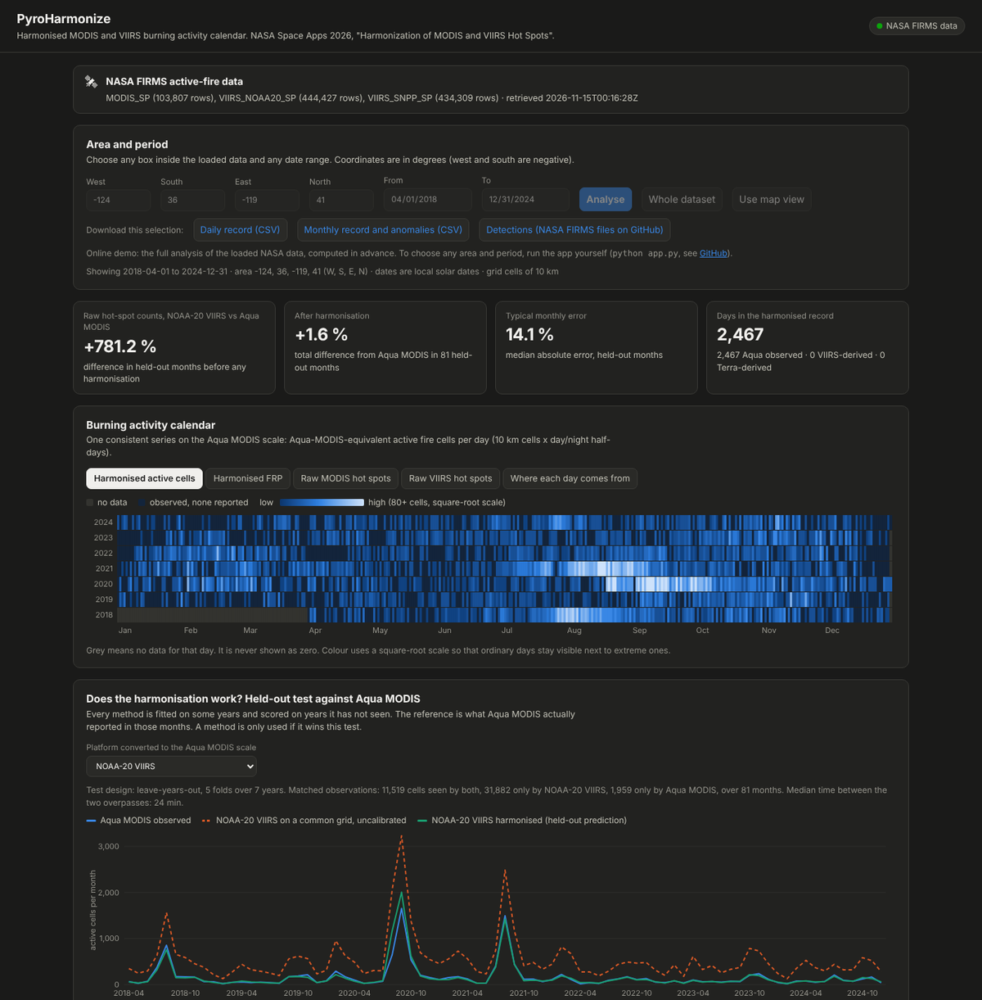

# PyroHarmonize

How much would the fire-activity calendar change if Aqua MODIS stopped reporting and only VIIRS remained? PyroHarmonize uses overlapping NASA FIRMS records to estimate the active grid cells Aqua would have reported.

[Open the northern California dashboard](https://jeeson-kurian.github.io/pyro-harmonize/) · [Design rationale](docs/DESIGN_RATIONALE.md) · [Run locally](#quick-start)



The clearest test withholds both MODIS instruments for 2023 and 2024. Across those 24 months, the VIIRS reconstruction underestimated Aqua's total active cells by **6.0% in northern California** and overestimated them by **2.9% in Portugal**. Median absolute monthly errors were **13.4%** and **14.5%**. Fire radiative power (FRP) was harder to reconstruct. Its totals were **37.6%** and **17.1%** below Aqua in the same two regions. Each region had its own calibration. [California report](docs/case_study/REPORT.md) · [Portugal report](docs/case_study_portugal/REPORT.md)

Built for the NASA Space Apps [Harmonization of MODIS and VIIRS Hot Spots challenge](https://www.spaceappschallenge.org/2026/challenges/modis-and-viirs-hot-spots/).

## The problem

Satellites have recorded active-fire hot spots since late 2000, but the record is split across instruments that cannot be compared directly. A MODIS pixel is about 1 km wide (and grows toward the edge of the swath); a VIIRS pixel is 375 m. One fire front is one MODIS hot spot and many VIIRS hot spots, VIIRS sees smaller fires, and there are now up to three VIIRS satellites. A plain hot-spot count therefore jumps when VIIRS starts and again with every added satellite, with no change in burning.

## The approach

1. Group detections by platform, grid cell (about 10 × 10 km) and local day or night. A fire front can produce several VIIRS pixels in the same cell.
2. Pair each platform with Aqua on dates covered by both. Compare a shared grid, a constant ratio and detection models on held-out periods. The selector tries candidates in order of complexity and switches only for a reduction of more than 2% in held-out scaled RMSE.
3. Keep Aqua observations where available. On other dates, average the calibrated VIIRS estimates available that day. Use calibrated Terra if neither source is available, and leave a gap if none qualifies.

Full description with equations and limits: [docs/METHODS.md](docs/METHODS.md).

## What the web app does

- **Any area, any period**: type a bounding box or copy it from the map, pick dates.
- **Burning activity calendar** (year x day of year): harmonised active cells, harmonised FRP, raw MODIS hot spots, raw VIIRS hot spots, and a view of which sensor each day comes from.
- **Validation panel**: held-out comparison against Aqua MODIS, every method in one table, the one in use marked.
- **Is this month unusual?** Anomaly against the same calendar month in other years, with percentile, coverage and a 90 % range.
- **Critical periods**: typical and busy weeks of the year, peak week, core season.
- **Fire season timing** per fire year, with trends reported as observed changes and no cause assigned.
- **Sensor comparison**: detection probability by FRP and FRP of cells seen by both.
- **Map of hot-spot clusters** (geodesic DBSCAN per overpass) and a clustering-radius sensitivity table.
- **CSV export** of detections (with FIRMS source, version and processing level), the daily record and the monthly record.

## Quick start

```bash
git clone https://github.com/Jeeson-Kurian/pyro-harmonize.git
cd pyro-harmonize
pip install -r requirements.txt -r requirements-dev.txt
python -m pytest -q          # automated tests
python app.py                # http://127.0.0.1:8000  (uses data/firms/; synthetic demo if it is empty)
```

### Use real NASA data

1. Get a free FIRMS MAP_KEY: <https://firms.modaps.eosdis.nasa.gov/api/map_key/>
2. Download one area and period (west,south,east,north):

```bash
export FIRMS_MAP_KEY=your_key            # Windows PowerShell: $env:FIRMS_MAP_KEY="your_key"
python data/download_nasa_firms.py --bbox -124,36,-119,41 --start 2012-01-20 --end 2024-12-31 \
       --sources MODIS_SP,VIIRS_SNPP_SP,VIIRS_NOAA20_SP
```

The script requests 5 days at a time, caches every request, retries failures, and writes `data/firms/manifest.json`, which records exactly which dates were retrieved. Re-running the same command resumes and retries only what failed. For the long MODIS-only record add a second run with `--start 2000-11-01 --sources MODIS_SP`.

Files from the FIRMS archive download tool (<https://firms.modaps.eosdis.nasa.gov/download/>) also work: put the CSVs in `data/firms/`.

3. Produce the validation report and start the app:

```bash
python scripts/run_case_study.py --update-readme   # writes docs/case_study/ and fills "Real-data result" below
python app.py
```

Steps 2 and 3 in one command (asks for the key if `FIRMS_MAP_KEY` is not set):

```bash
python scripts/make_submission.py
```

Commit `data/firms/*.csv`, `data/firms/manifest.json` and `docs/case_study/` so that others can reproduce the result.

**More regions.** Each extra region gets its own data folder (`data/regions/<name>/`) and report (`docs/case_study_<name>/`), and the "Real-data result" section below lists every region:

```bash
python scripts/make_submission.py --name portugal --label "Portugal" --bbox -9.6,36.9,-6.1,42.2
```

To open that region in the app, set `PYRO_DATA_DIR=data/regions/portugal` before `python app.py`.

Settings: `PYRO_DATA_DIR` (other data folder), `PYRO_DEMO=1` (force the synthetic demo), `HOST`, `PORT`.

### Online demo (GitHub Pages)

`python scripts/build_static_site.py` writes a static copy of the dashboard to `docs/index.html` and `docs/demo-data/`, with the analysis of `data/firms/` computed in advance. GitHub Pages serves it when the repository setting **Pages → Deploy from a branch → main → /docs** is on. Static hosting cannot run Python, so the online demo shows the whole loaded dataset; choosing another area or period needs the full app. Run the script again after the data change.

## Real-data result

<!-- CASE_STUDY:START -->
**Northern California, USA** (west, south, east, north: -124, 36, -119, 41). Period: 2018-04-01 to 2024-12-31. Data: NASA FIRMS, 908,032 detections after quality control. Full report: [docs/case_study/REPORT.md](docs/case_study/REPORT.md).

| Platform compared with Aqua MODIS (held-out months) | Raw hot spots | Common grid only | After harmonisation | Median monthly error | Forward-in-time test | Method used |
|---|---:|---:|---:|---:|---:|---|
| Terra MODIS (81 months) | +7.0 % | +4.2 % | +4.2 % | 26.3 % | +2.4 % | Common grid only (no calibration) |
| Suomi-NPP VIIRS (81 months) | +764.0 % | +210.7 % | +1.8 % | 13.2 % | -8.5 % | Common grid + detection model with time of year |
| NOAA-20 VIIRS (81 months) | +781.2 % | +222.0 % | +1.6 % | 14.1 % | -3.5 % | Common grid + detection model with time of year |

MODIS switched off from 2023-01-01 (calibration on earlier years only): raw VIIRS hot spots +523.0 %; record continued from VIIRS -6.0 % against what Aqua MODIS really observed, median monthly error 13.4 %, 96 % of months inside the 90 % band; FRP -37.6 %.

**Portugal** (west, south, east, north: -9.6, 36.9, -6.1, 42.2). Period: 2018-04-01 to 2024-12-31. Data: NASA FIRMS, 93,811 detections after quality control. Full report: [docs/case_study_portugal/REPORT.md](docs/case_study_portugal/REPORT.md).

| Platform compared with Aqua MODIS (held-out months) | Raw hot spots | Common grid only | After harmonisation | Median monthly error | Forward-in-time test | Method used |
|---|---:|---:|---:|---:|---:|---|
| Terra MODIS (81 months) | +0.6 % | -0.8 % | -0.8 % | 20.6 % | -2.4 % | Common grid only (no calibration) |
| Suomi-NPP VIIRS (81 months) | +500.4 % | +249.2 % | +0.3 % | 14.7 % | +5.2 % | Common grid + detection model with time of year |
| NOAA-20 VIIRS (81 months) | +514.0 % | +271.5 % | +0.1 % | 14.3 % | +0.6 % | Common grid + detection model with time of year |

MODIS switched off from 2023-01-01 (calibration on earlier years only): raw VIIRS hot spots +628.4 %; record continued from VIIRS +2.9 % against what Aqua MODIS really observed, median monthly error 14.5 %, 92 % of months inside the 90 % band; FRP -17.1 %.

The raw column compares target and Aqua hot-spot counts. The grid and harmonised columns compare active cells against Aqua. Total bias can cancel errors of opposite signs across months. The median monthly error uses absolute errors for months with more than five observed Aqua cells. Each region was fitted and tested on its own data.
<!-- CASE_STUDY:END -->

## Self-test on simulated data

`python scripts/run_case_study.py --demo --out docs/synthetic_selftest` runs the whole pipeline on a simulator that is independent of the harmonisation code (fires with sub-pixel structure, pixel footprints, detection limits, cloud, separate orbits, a sensor outage). In that simulated world:

| Suomi-NPP VIIRS compared with Aqua MODIS, held-out years | Total difference |
|---|---:|
| Raw hot-spot counts | +217 % |
| Common grid only | +143 % |
| After harmonisation (cross-validation) | 0 % (median monthly error 6 %) |
| After harmonisation (forward-in-time test) | +3 % |

In a blind test on a second simulated world (`tests/test_harmonization.py`), Aqua was hidden for the last four years and reconstructed from VIIRS: the monthly totals matched the hidden Aqua record within 2 % overall (correlation 0.997), and 92 % of months fell inside the 90 % range.

**These numbers describe the simulator, not the Earth.** They show that the code does what it says. Real-data numbers come from `docs/case_study/REPORT.md`.

## Data and citation

Active-fire data come from NASA FIRMS (Fire Information for Resource Management System), part of NASA's LANCE / EOSDIS: MODIS Collection 6.1 active fire products (Terra, Aqua) and VIIRS 375 m active fire products (Suomi-NPP, NOAA-20, NOAA-21). <https://firms.modaps.eosdis.nasa.gov/>

We acknowledge the use of data from NASA's Fire Information for Resource Management System (FIRMS), part of NASA's Earth Science Data and Information System (ESDIS).

## Limits

- Two regions are validated (northern California and Portugal). That does not prove the method works in every fire regime; run the case study for each area you care about.
- Hot-spot files do not say where the satellite looked and saw nothing, or where cloud hid the ground.
- FRP values are instantaneous power at overpass time. They are not energy. Harmonised FRP is less certain than harmonised cell counts: the Aqua/VIIRS FRP ratio for the same cells changes from year to year (see the observing-system check in the report).
- Terra and Aqua have drifted from their original orbits; the report measures this from the data (Aqua's daytime overpass moved from about 13:10 to 13:43 local solar time by 2024).
- Terra-derived values (before July 2002) cross the diurnal cycle and are the least certain part of the record.
- Trends are observed changes in a mixed-sensor record. No cause is assigned.
- Not for operational fire-fighting decisions.

More in [docs/METHODS.md](docs/METHODS.md), section 11.

## Use of AI

Claude assisted with implementation, tests and documentation. The [MODIS switch-off commit](https://github.com/Jeeson-Kurian/pyro-harmonize/commit/5199d46f412a7fdd7e0265c9c110eff9b6601d20) records Claude as a co-author. Codex assisted with the design rationale and documentation revisions. ChatGPT wrote the 14 November review that prompted the redesign; its technical findings are ChatGPT's. The dashboard renders charts from the selected dataset. The published regional reports use NASA FIRMS observations, and the simulator supplies labelled synthetic data for tests and demo mode.

## Project layout

```
app.py                       web API (FastAPI) and page
web/index.html               dashboard (charts drawn in the page, map with Leaflet)
engine/data_loader.py        FIRMS ingestion and quality control
engine/gridding.py           equal-area cells, local half-days, overpasses
engine/matching.py           coverage and cross-sensor pairs
engine/harmonizer.py         calibration candidates, held-out validation, selection
engine/pipeline.py           end-to-end analysis and exports
engine/calendar_generator.py calendar, fire years, trends
engine/anomaly.py            monthly anomalies, critical weeks
engine/spatial_cluster.py    geodesic hot-spot clustering (map only)
engine/synthetic.py          simulator for tests and demo mode
data/download_nasa_firms.py  FIRMS downloader
scripts/run_case_study.py    reproducible validation report
scripts/make_submission.py   download + report + README result in one command
scripts/build_static_site.py online demo for GitHub Pages (docs/index.html, docs/demo-data/)
scripts/merge_firms.py       join downloads of one area (e.g. an earlier period)
tests/                       automated tests
docs/METHODS.md              method, validation and limits
```

## Submission

- Event: NASA International Space Apps Challenge Ahlen 2026
- Challenge: Harmonization of MODIS and VIIRS Hot Spots
- Lead Organizer: GDG Ahlen / NASA Space Apps Local Lead Anna Muzykina
- Team: PyroHarmonize

## License

MIT. See [LICENSE](LICENSE).
