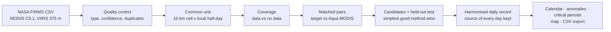

# PyroHarmonize

**A burning activity calendar that puts MODIS and VIIRS active-fire records on one scale, and shows how well that works.**

<p align="center">
  <a href="https://jeeson-kurian.github.io/pyro-harmonize/"></a>
</p>

<p align="center">
  <b>Live demo: <a href="https://jeeson-kurian.github.io/pyro-harmonize/">jeeson-kurian.github.io/pyro-harmonize</a></b><br>
  Opens in any browser, nothing to install. Real NASA FIRMS data for three regions you can switch between: northern California (November 2000 to December 2024), Portugal and northern Australia (April 2018 to December 2024).
</p>

<p align="center">
  <a href="https://jeeson-kurian.github.io/pyro-harmonize/"></a><br>
  <sub>Click the picture to open the live dashboard.</sub>
</p>

NASA Space Apps Challenge 2026 · challenge: *Harmonization of MODIS and VIIRS Hot Spots* · [challenge page](https://www.spaceappschallenge.org/2026/challenges/modis-and-viirs-hot-spots/)

[](https://github.com/Jeeson-Kurian/pyro-harmonize/actions/workflows/tests.yml)
[](LICENSE)

**Live demo:** <https://jeeson-kurian.github.io/pyro-harmonize/> shows the full analysis of the NASA FIRMS data for each validated region (northern California, Portugal, northern Australia; choose it at the top of the page), computed in advance. To choose any area and period, run the app as described in [Quick start](#quick-start).

---

## Status: read this first

| | |
|---|---|
| Real-data pipeline (download, quality control, harmonisation, validation, web app) | **Implemented and covered by automated tests** |
| Real NASA FIRMS case study | **Done for three regions and two fire regimes:** northern California, November 2000 to December 2024 (991,188 detections after quality control); Portugal (93,811) and the tropical savanna of northern Australia (1,872,939), April 2018 to December 2024. On months the model never saw, harmonisation cuts the difference between VIIRS and Aqua MODIS from about +500 % to +780 % (raw hot spots) to under 2 % in every region. Details: [Real-data result](#real-data-result) and the reports for [California](docs/case_study/REPORT.md), [Portugal](docs/case_study_portugal/REPORT.md) and [northern Australia](docs/case_study_australia/REPORT.md). |
| MODIS switched off (simulated end of mission) | **Tested in all three regions.** MODIS removed for 2023 and 2024, calibration fitted on the earlier years only, record continued from VIIRS alone: −6.0 % (California), +2.9 % (Portugal) and −6.3 % (northern Australia) against what Aqua MODIS really observed, where raw VIIRS hot spots would give +523 %, +628 % and +600 %. Shown live in the online demo. Details: [Real-data result](#real-data-result). |
| Robustness checks | **Done, results reported as they are** ([docs/robustness/REPORT.md](docs/robustness/REPORT.md)). A calibration fitted in one region and applied unchanged to another still removes most of the raw gap, but leaves 22 to 55 % monthly error, against 6 to 15 % with the region's own calibration, so every region is calibrated on its own data. Switching MODIS off for 2021-22 (before Aqua's orbit drift) and for 2023-24 gives similar active-cell results in all three regions (−8 % to +3 %). |
| What it does not show yet | That the method works in every fire regime (boreal forest and crop burning are not tested), or agreement with fire on the ground: Aqua MODIS is the reference, not ground truth. A new area needs its own calibration. |

## The problem

Satellites have recorded active-fire hot spots since late 2000, but the record is split across instruments that cannot be compared directly. A MODIS pixel is about 1 km wide (and grows toward the edge of the swath); a VIIRS pixel is 375 m. One fire front is one MODIS hot spot and many VIIRS hot spots, VIIRS sees smaller fires, and there are now up to three VIIRS satellites. A plain hot-spot count therefore jumps when VIIRS starts and again with every added satellite, with no change in burning.

This matters now. The Suomi-NPP active-fire data stream stopped on 2 November 2026 ([NASA Earthdata](https://www.earthdata.nasa.gov/news/blog/transitioning-from-suomi-npp-viirs-omps-what-firms-users-need-know)), and NASA plans to stop science data collection from Aqua MODIS in September 2027 and Terra MODIS in February 2027 ([NASA LAADS DAAC](https://ladsweb.modaps.eosdis.nasa.gov/learn/modis-to-viirs-transition/)). NASA FIRMS points users to NOAA-20 and NOAA-21 VIIRS for the afternoon observations once Aqua ends. The fire record has to continue on them without a break in meaning: the switch-off test in this repository simulates exactly that moment.

## The approach

1. **One unit for every sensor.** Hot spots are reduced to *active fire cells*: 10 km equal-area grid cells per local day or night. This removes most of the pixel-size effect before any modelling.
2. **One reference scale.** Everything is expressed as "what Aqua MODIS would have reported". A coarse sensor cannot be upgraded to see what it missed, but a fine one can be degraded. Aqua shares the early-afternoon orbit with every VIIRS satellite; Terra (morning orbit) is handled separately.
3. **Calibration on matched observations.** For cells that a VIIRS platform reports, a model estimates the probability that Aqua MODIS reports them too, and their expected Aqua FRP.
4. **Held-out validation decides.** The model competes with simple baselines on years it has not seen, and on a forward-in-time split. The simplest method within 2 % of the best is used. If the data are too thin to validate anything, the platform is reported as "not calibrated" and left out. There are no fallback numbers in the code.
5. **Missing is not zero.** Days without data coverage are shown as missing everywhere. Several satellites are averaged, never added.



Full description with equations and limits: [docs/METHODS.md](docs/METHODS.md).

## What the web app does

- **Any area, any period**: type a bounding box or copy it from the map, pick dates.
- **Burning activity calendar** (year x day of year): harmonised active cells, harmonised FRP, raw MODIS hot spots, raw VIIRS hot spots, and a view of which sensor each day comes from.
- **Validation panel**: held-out comparison against Aqua MODIS, every method in one table, the one in use marked.
- **Is this month unusual?** Anomaly against the same calendar month in other years, with percentile, coverage and a 90 % range.
- **Critical periods**: typical and busy weeks of the year, peak week, core season.
- **Fire season timing** per fire year, with trends reported as observed changes and no cause assigned.
- **Sensor comparison**: detection probability by FRP and FRP of cells seen by both.
- **Map of hot-spot clusters** (geodesic DBSCAN per overpass) and a clustering-radius sensitivity table.
- **CSV export** of detections (with FIRMS source, version and processing level), the daily record and the monthly record.

## Quick start

```bash
git clone https://github.com/Jeeson-Kurian/pyro-harmonize.git
cd pyro-harmonize
pip install -r requirements.txt -r requirements-dev.txt
python -m pytest -q          # automated tests
python app.py                # http://127.0.0.1:8000  (uses data/firms/; synthetic demo if it is empty)
```

### Use real NASA data

1. Get a free FIRMS MAP_KEY: <https://firms.modaps.eosdis.nasa.gov/api/map_key/>
2. Download one area and period (west,south,east,north):

```bash
export FIRMS_MAP_KEY=your_key            # Windows PowerShell: $env:FIRMS_MAP_KEY="your_key"
python data/download_nasa_firms.py --bbox -124,36,-119,41 --start 2012-01-20 --end 2024-12-31 \
       --sources MODIS_SP,VIIRS_SNPP_SP,VIIRS_NOAA20_SP
```

The script requests 5 days at a time, caches every request, retries failures, and writes `data/firms/manifest.json`, which records exactly which dates were retrieved. Re-running the same command resumes and retries only what failed. For the long MODIS-only record add a second run with `--start 2000-11-01 --sources MODIS_SP`.

Files from the FIRMS archive download tool (<https://firms.modaps.eosdis.nasa.gov/download/>) also work: put the CSVs in `data/firms/`.

3. Produce the validation report and start the app:

```bash
python scripts/run_case_study.py --update-readme   # writes docs/case_study/ and fills "Real-data result" below
python app.py
```

Steps 2 and 3 in one command (asks for the key if `FIRMS_MAP_KEY` is not set):

```bash
python scripts/make_submission.py
```

Commit `data/firms/*.csv`, `data/firms/manifest.json` and `docs/case_study/` so that others can reproduce the result.

**More regions.** Each extra region gets its own data folder (`data/regions/<name>/`) and report (`docs/case_study_<name>/`), and the "Real-data result" section below lists every region:

```bash
python scripts/make_submission.py --name portugal --label "Portugal" --bbox -9.6,36.9,-6.1,42.2
```

To open that region in the app, set `PYRO_DATA_DIR=data/regions/portugal` before `python app.py`.

Settings: `PYRO_DATA_DIR` (other data folder), `PYRO_DEMO=1` (force the synthetic demo), `HOST`, `PORT`.

### Online demo (GitHub Pages)

`python scripts/build_static_site.py` writes a static copy of the dashboard to `docs/index.html` and `docs/demo-data/`, with the analysis of `data/firms/` computed in advance. GitHub Pages serves it when the repository setting **Pages → Deploy from a branch → main → /docs** is on. Static hosting cannot run Python, so the online demo shows the whole loaded dataset; choosing another area or period needs the full app. Run the script again after the data change.

## Real-data result

<!-- CASE_STUDY:START -->
**Northern California, USA** (west, south, east, north: -124, 36, -119, 41). Period: 2000-11-01 to 2024-12-31. Data: NASA FIRMS, 991,188 detections after quality control. Full report: [docs/case_study/REPORT.md](docs/case_study/REPORT.md).

| Platform compared with Aqua MODIS (held-out months) | Raw hot spots | Common grid only | After harmonisation | Median monthly error | Forward-in-time test | Method used |
|---|---:|---:|---:|---:|---:|---|
| Terra MODIS (270 months) | +1.1 % | -0.9 % | -0.9 % | 20.3 % | +4.9 % | Common grid only (no calibration) |
| Suomi-NPP VIIRS (81 months) | +764.0 % | +210.6 % | +1.8 % | 13.2 % | -8.5 % | Common grid + detection model with time of year |
| NOAA-20 VIIRS (81 months) | +781.2 % | +222.0 % | +1.5 % | 14.1 % | -3.5 % | Common grid + detection model with time of year |

MODIS switched off from 2023-01-01 (calibration on earlier years only): raw VIIRS hot spots +523.0 %; record continued from VIIRS -6.0 % against what Aqua MODIS really observed, median monthly error 13.4 %, 96 % of months inside the 90 % band; FRP -37.6 %.

**Northern Australia (tropical savanna)** (west, south, east, north: 131, -16, 135, -12). Period: 2018-04-01 to 2024-12-31. Data: NASA FIRMS, 1,872,939 detections after quality control. Full report: [docs/case_study_australia/REPORT.md](docs/case_study_australia/REPORT.md).

| Platform compared with Aqua MODIS (held-out months) | Raw hot spots | Common grid only | After harmonisation | Median monthly error | Forward-in-time test | Method used |
|---|---:|---:|---:|---:|---:|---|
| Terra MODIS (80 months) | -40.5 % | -34.2 % | -0.4 % | 39.1 % | -16.6 % | Common grid + one constant ratio |
| Suomi-NPP VIIRS (81 months) | +633.9 % | +201.4 % | -0.1 % | 5.8 % | -8.5 % | Common grid + detection model with time of year |
| NOAA-20 VIIRS (81 months) | +626.9 % | +209.8 % | +0.1 % | 6.2 % | -4.2 % | Common grid + detection model with time of year |

MODIS switched off from 2023-01-01 (calibration on earlier years only): raw VIIRS hot spots +599.7 %; record continued from VIIRS -6.3 % against what Aqua MODIS really observed, median monthly error 7.1 %, 83 % of months inside the 90 % band; FRP +1.4 %.

**Portugal** (west, south, east, north: -9.6, 36.9, -6.1, 42.2). Period: 2018-04-01 to 2024-12-31. Data: NASA FIRMS, 93,811 detections after quality control. Full report: [docs/case_study_portugal/REPORT.md](docs/case_study_portugal/REPORT.md).

| Platform compared with Aqua MODIS (held-out months) | Raw hot spots | Common grid only | After harmonisation | Median monthly error | Forward-in-time test | Method used |
|---|---:|---:|---:|---:|---:|---|
| Terra MODIS (81 months) | +0.6 % | -0.8 % | -0.8 % | 20.6 % | -2.4 % | Common grid only (no calibration) |
| Suomi-NPP VIIRS (81 months) | +500.4 % | +249.2 % | +0.3 % | 14.7 % | +5.2 % | Common grid + detection model with time of year |
| NOAA-20 VIIRS (81 months) | +514.0 % | +271.5 % | +0.1 % | 14.3 % | +0.6 % | Common grid + detection model with time of year |

MODIS switched off from 2023-01-01 (calibration on earlier years only): raw VIIRS hot spots +628.4 %; record continued from VIIRS +2.9 % against what Aqua MODIS really observed, median monthly error 14.5 %, 92 % of months inside the 90 % band; FRP -17.1 %.

Percentages are total differences from what Aqua MODIS reported in months that were not used for fitting. Each region was fitted and tested on its own data.
<!-- CASE_STUDY:END -->

## Self-test on simulated data

`python scripts/run_case_study.py --demo --out docs/synthetic_selftest` runs the whole pipeline on a simulator that is independent of the harmonisation code (fires with sub-pixel structure, pixel footprints, detection limits, cloud, separate orbits, a sensor outage). In that simulated world:

| Suomi-NPP VIIRS compared with Aqua MODIS, held-out years | Total difference |
|---|---:|
| Raw hot-spot counts | +217 % |
| Common grid only | +143 % |
| After harmonisation (cross-validation) | 0 % (median monthly error 6 %) |
| After harmonisation (forward-in-time test) | +3 % |

In a blind test on a second simulated world (`tests/test_harmonization.py`), Aqua was hidden for the last four years and reconstructed from VIIRS: the monthly totals matched the hidden Aqua record within 2 % overall (correlation 0.997), and 92 % of months fell inside the 90 % range.

**These numbers describe the simulator, not the Earth.** They show that the code does what it says. Real-data numbers come from `docs/case_study/REPORT.md`.

## Implemented and not implemented

| Implemented | Not implemented |
|---|---|
| FIRMS API downloader with manifest, caching, retries | Automatic download from inside the web app |
| Ingestion of API and archive CSV layouts, SP and NRT | Cloud and swath masks (not available from hot-spot files) |
| Quality control with per-rule counts | Land-cover or biome-specific calibration |
| Equal-area cells, local-solar half-days, geodesic clustering | Fire radiative energy (time-integrated FRP) |
| Per-platform calibration with held-out and forward tests | Validation across many regions |
| Aqua-equivalent daily record with per-day source | Forecasting |
| Empirical 90 % range for sensor-converted months | Formal error propagation |
| Calendar, anomalies, critical weeks, fire-year seasonality | Polygon areas (bounding boxes only) |
| CSV export with provenance | |

## Data and citation

Active-fire data come from NASA FIRMS (Fire Information for Resource Management System), part of NASA's LANCE / EOSDIS: MODIS Collection 6.1 active fire products (Terra, Aqua) and VIIRS 375 m active fire products (Suomi-NPP, NOAA-20, NOAA-21). <https://firms.modaps.eosdis.nasa.gov/>

We acknowledge the use of data from NASA's Fire Information for Resource Management System (FIRMS), part of NASA's Earth Science Data and Information System (ESDIS).

## Limits

- Three regions are validated (northern California, Portugal, northern Australia), covering summer-dry wildfires and tropical savanna fires. Each has its own calibration: one fitted elsewhere and applied unchanged leaves 22 to 55 % monthly error instead of 6 to 15 % ([robustness checks](docs/robustness/REPORT.md)). That does not prove the method works in every fire regime; run the case study for each area you care about.
- Hot-spot files do not say where the satellite looked and saw nothing, or where cloud hid the ground.
- FRP values are instantaneous power at overpass time. They are not energy. Harmonised FRP is less certain than harmonised cell counts. It held in the northern Australian savanna (+1.4 % when MODIS was switched off) but not in California (−37.6 %) or Portugal (−17.1 %), where the Aqua/VIIRS FRP ratio for the same cells changes from year to year (see the observing-system check in each report). In California, FRP continued better when MODIS was switched off before Aqua's orbit drift (−19.8 % for 2021-22) than after it (−37.6 % for 2023-24); in Portugal it was poor in both periods ([robustness checks](docs/robustness/REPORT.md)).
- Terra and Aqua have drifted from their original orbits; the report measures this from the data. In California, Aqua's median daytime detection time stayed between 13:02 and 13:13 local solar time from 2002 to 2022, then moved to 13:25 in 2023 and 13:43 in 2024. This is consistent with NASA's note that Aqua began drifting to a later local overpass time in July 2021 ([NSIDC](https://nsidc.org/ru/node/51980)); the report measures the median local solar time of daytime detections, not the equator-crossing time.
- The 90 % band comes from the scatter of held-out months. In the switch-off tests it contained the real Aqua value in 96 % of months in California but only 75 to 92 % in Portugal and northern Australia, so there it is too narrow.
- Terra-derived values (before July 2002) cross the diurnal cycle and are the least certain part of the record.
- Trends are observed changes in a mixed-sensor record. No cause is assigned.
- Not for operational fire-fighting decisions.

More in [docs/METHODS.md](docs/METHODS.md), section 11.

## Use of AI

Parts of the code, tests and documentation in this repository were written with the assistance of an AI model (Claude, by Anthropic). No AI-generated images, video or audio are used: every chart, map and screenshot is drawn by this software from NASA FIRMS data. The data are NASA FIRMS data, or simulated data that are labelled as synthetic wherever they appear.

## Project layout

```
app.py                       web API (FastAPI) and page
web/index.html               dashboard (charts drawn in the page, map with Leaflet)
engine/data_loader.py        FIRMS ingestion and quality control
engine/gridding.py           equal-area cells, local half-days, overpasses
engine/matching.py           coverage and cross-sensor pairs
engine/harmonizer.py         calibration candidates, held-out validation, selection
engine/pipeline.py           end-to-end analysis and exports
engine/calendar_generator.py calendar, fire years, trends
engine/anomaly.py            monthly anomalies, critical weeks
engine/spatial_cluster.py    geodesic hot-spot clustering (map only)
engine/synthetic.py          simulator for tests and demo mode
data/download_nasa_firms.py  FIRMS downloader
scripts/run_case_study.py    reproducible validation report
scripts/make_submission.py   download + report + README result in one command
scripts/build_static_site.py online demo for GitHub Pages (docs/index.html, docs/demo-data/)
scripts/merge_firms.py       join downloads of one area (e.g. an earlier period)
scripts/run_robustness.py    calibration transfer between regions; switch-off before and after the orbit drift (docs/robustness/)
tests/                       automated tests
docs/METHODS.md              method, validation and limits
```

## Submission

- Event: NASA International Space Apps Challenge Ahlen 2026
- Challenge: Harmonization of MODIS and VIIRS Hot Spots
- Target Global Awards: Best Use of Data / Galactic Impact
- Lead Organizer: GDG Ahlen / NASA Space Apps Local Lead Anna Muzykina
- Team: PyroHarmonize

## License

MIT. See [LICENSE](LICENSE).
